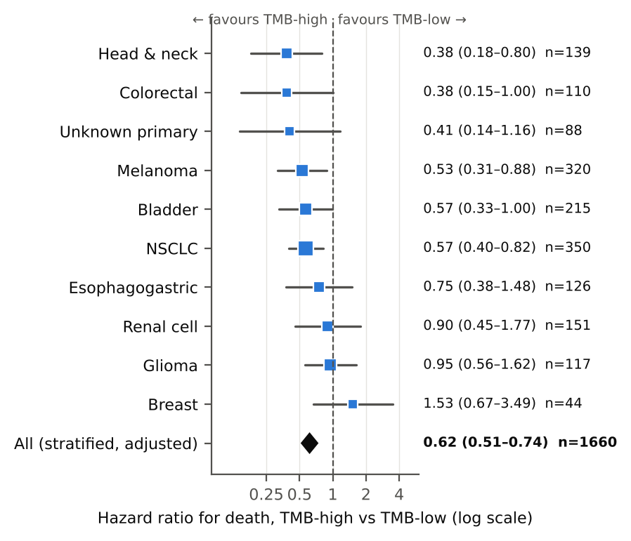

# Replication: TMB and survival after immune checkpoint inhibitors (Samstein et al., Nat Genet 2019)

Re-analysis of the public MSK-IMPACT ICI cohort (cBioPortal study `tmb_mskcc_2018`, 1,661 patients).

**Report:** [manuscript-style write-up](https://claude.ai/artifact/3L3XH9p6g7Cf7QHWh6Wsp8)

**Headline:** TMB in the top 20% within histology was associated with lower mortality after ICI — adjusted HR 0.62 (95% CI 0.51–0.74; 1,660 patients, 832 deaths). No benefit in glioma (HR 0.95). TMB × cancer-type interaction p = 0.18; proportional hazards held (p = 0.88).



## Run

```bash
pip install pandas numpy scipy statsmodels lifelines matplotlib patsy
# raw files (from cBioPortal DataHub) go in data/raw/
python 01_build_dataset.py   # analysis dataset + data dictionary + QC (exits 1 if a hard check fails)
python 02_analysis.py        # all tables, models and figures
```

Raw data (included in `data/raw/`) source: https://github.com/cBioPortal/datahub/tree/master/public/tmb_mskcc_2018
(`data_clinical_patient.txt`, `data_clinical_sample.txt`).

## Files

| Path | Contents |
| --- | --- |
| `data/analysis.csv` | Analysis dataset, one row per patient |
| `data/data_dictionary.csv` | Every variable: type, definition, source field, notes |
| `output/qc_report.txt` | Scripted QC checks and histology-specific TMB cut-offs |
| `output/table1_by_cancer_type.csv` | Table 1 (full) |
| `output/tmb_prevalence_by_cancer_type.csv` | TMB-high prevalence by histology |
| `output/logistic_tmb_ge10.csv` | Logistic model, P(TMB >= 10 mut/Mb) |
| `output/cox_primary_stratified.csv` | Primary Cox model (stratified by cancer type) |
| `output/cox_by_histology.csv` | Per-histology HRs, log-rank p, PH test, median OS |
| `output/schoenfeld_tests_primary.csv` | Schoenfeld residual tests, primary model |
| `output/sensitivity_analyses.csv` | Alternative cut-offs and populations |
| `output/results.json` | Every number quoted in the report |
| `figures/` | Fig 1 pooled KM, Fig 2 forest, Fig 3 spline, S1 KM by histology, S2 Schoenfeld |

## Key definitions

- **TMB-high (primary):** TMB >= 80th percentile within histology (ties counted high).
- **Primary Cox model:** stratified by cancer type; adjusted for age group, drug class, MSK-IMPACT panel version.
- **Era proxy:** treatment year is not in the public release; panel version (341 -> 410 -> 468) stands in.
- **Excluded from per-histology analyses:** Skin Cancer, Non-Melanoma (n = 1).
